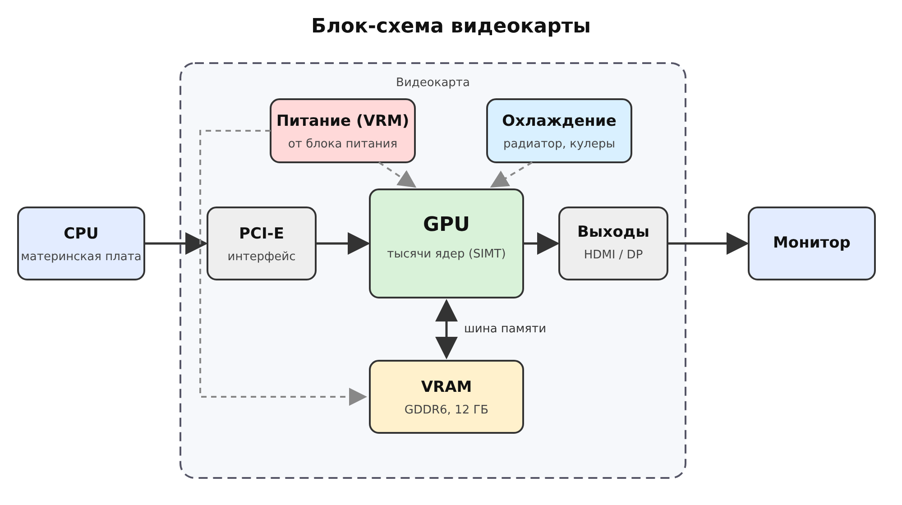

# ДЗ: Устройство видеокарты (GPU)

Абдуллаев Билолиддин Низомидинович, группа 9/2-РПО-25/3

## Часть 1. Теория

### 1. Пять основных блоков видеокарты

| Блок | Назначение |
| --- | --- |
| **GPU** (графический процессор) | Выполняет вычисления и строит изображение |
| **VRAM** (видеопамять) | Хранит текстуры, модели и готовые кадры |
| **Подсистема питания** (VRM) | Преобразует напряжение от блока питания и стабильно питает GPU и память |
| **Система охлаждения** | Радиатор, тепловые трубки и вентиляторы отводят тепло |
| **Интерфейсы** | PCI‑E связывает карту с материнской платой, HDMI/DisplayPort выводят картинку на монитор |

### 2. Чем GPU отличается от CPU

| | CPU | GPU |
| --- | --- | --- |
| Ядра | Несколько мощных универсальных ядер | Тысячи простых ядер |
| Тип обработки | Последовательные задачи со сложной логикой и ветвлениями | Одна операция сразу над огромным массивом данных |
| Выгоден для | ОС, программ, логики игры | Графики, обработки видео, обучения нейросетей |

### 3. VRAM

VRAM — отдельная память на самой видеокарте, которой пользуется только GPU. По сравнению с ОЗУ у неё намного шире шина и выше пропускная способность (GDDR6/GDDR6X/HBM против DDR4/DDR5).

Её делают максимально быстрой, потому что тысячи ядер GPU одновременно запрашивают данные. Если память не успевает их подавать, ядра простаивают.

### 4. SIMT и варпы

SIMT означает, что одну и ту же команду одновременно выполняет множество потоков, каждый над своими данными. Например, команда «посчитать цвет» выполняется сразу для тысяч пикселей.

GPU объединяет потоки в варпы (у NVIDIA по 32 потока). Так одним управляющим блоком можно запускать сразу много потоков, и ресурсы чипа расходуются эффективнее.

### 5. Охлаждение и питание

Под нагрузкой GPU потребляет сотни ватт и сильно греется. Подсистема питания обеспечивает стабильное напряжение, охлаждение отводит тепло.

Если охлаждение не справляется:

1. Начинается троттлинг: частоты снижаются, FPS падает.
2. Появляются артефакты на экране и вылеты.
3. Срабатывает аварийное отключение.
4. При долгом перегреве компоненты деградируют.

## Часть 2. Схема

Путь данных: CPU → PCI‑E → GPU ⇄ VRAM (по шине памяти) → разъёмы вывода → монитор. Питание и охлаждение обслуживают GPU.

## Часть 3. Практика

### 7. Характеристики видеокарты

Модель: **NVIDIA GeForce RTX 3060**.

| Характеристика | Значение |
| --- | --- |
| Объём VRAM | 12 ГБ |
| Тип памяти | GDDR6 |
| Ширина шины | 192 бит |
| Число CUDA‑ядер | 3584 |
| TDP | 170 Вт |

Источник: GPU‑Z / `nvidia-smi` / «Диспетчер задач» → «Производительность» → «GPU».

### 8. Пропускная способность памяти

**Пропускная способность = 360 ГБ/с, что совпадает с паспортным значением.**

ПС = частота (МГц) × ширина шины (бит) / 8 = 15000 × 192 / 8 = 360 000 МБ/с = **360 ГБ/с**

Берётся эффективная частота памяти. GPU‑Z показывает реальную частоту 1875 МГц, а для GDDR6 эффективная в 8 раз больше: 15000 МГц.

| | Значение |
| --- | --- |
| Расчёт | 360 ГБ/с |
| По паспорту | 360 ГБ/с |

### 9. От «Запустить игру» до картинки на экране

1. **CPU** загружает игру с диска в оперативную память и запускает её логику.
2. Текстуры, модели и шейдеры передаются по PCI‑E в **VRAM**.
3. В каждом кадре **CPU** считает физику, ИИ и ввод игрока и отправляет GPU команды отрисовки (draw calls).
4. **GPU** берёт данные из VRAM и параллельно обрабатывает вершины, растеризует сцену и считает цвет каждого пикселя.
5. Готовый кадр записывается в буфер кадра во **VRAM**.
6. Через HDMI/DisplayPort кадр уходит на монитор. Цикл повторяется десятки и сотни раз в секунду (FPS).

## Часть 4. Вывод

Видеокарты нужны не только для игр, но и для ИИ, потому что их сила в массовом параллелизме. Обучение и работа нейросетей сводятся к огромному количеству однотипных операций, в основном перемножению матриц. Такие операции легко разделить между тысячами ядер GPU, которые выполняют их одновременно. CPU с несколькими ядрами справлялся бы с этим в десятки раз медленнее. Быстрая VRAM позволяет держать рядом с ядрами большие массивы данных и веса модели.
